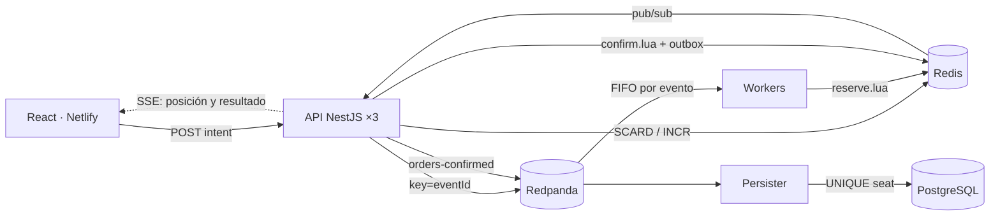

# Flash-Sale Ticketing Engine

Motor de venta de entradas para picos de demanda extremos (estilo Ticketmaster): **5.000 usuarios compran 100 entradas en el mismo milisegundo, sin sobreventa y sin tumbar la base de datos.**

**NestJS (Fastify) · Redis + Lua · Redpanda (Kafka API) · PostgreSQL · SSE · React/Netlify · Docker/Dokploy · k6**



## Resultados (medidos)

| Prueba | Resultado |
|---|---|
| 5.000 reservas concurrentes contra 100 asientos (solo Redis) | **331 ms**, exactamente 100 holds, 0 duplicados |
| k6, 5.000 VUs, pico simultáneo, 20 % abandona sin pagar | **100/100 vendidos**, 0 sobreventa, PG = Redis, 0 % errores HTTP |
| TTL | 29 holds abandonados devueltos al stock y revendidos dentro de la misma prueba |
| Gate de admisión | mediana 2 ms; ~95 % de los intentos rechazados en el borde sin tocar la cola |

Detalle y matices (p. ej. por qué el p95 local depende de dónde corre k6) en [docs/LOAD_TESTING.md](docs/LOAD_TESTING.md).

## Cómo resuelve los tres retos

1. **Sobreventa** → el stock es un `SET` en Redis y solo sale de él mediante `SPOP`/`SREM` dentro de un script Lua atómico. Además, `UNIQUE (event_id, seat_id)` en PostgreSQL actúa como última línea de defensa.
2. **Absorción del tráfico** → el gate responde `202` en milisegundos y la intención va a Kafka con `key = eventId` (una partición por evento = FIFO). Los workers procesan en lotes, cada lote en un solo pipeline de Redis.
3. **Bloqueo temporal** → los holds viven en un `ZSET` ordenado por expiración (reloj de Redis). Vuelven al stock por un reaper que corre cada segundo y también de forma perezosa en cada reserva. No depende de keyspace notifications, que pueden perderse.

## Inicio rápido

```bash
docker compose -f docker-compose.yml -f docker-compose.dev.yml up -d --build

# abrir la venta (carga los asientos de PG en Redis)
curl -X POST "localhost:3000/admin/events/1/open-sale?reset=true" -H "x-admin-token: dev-admin-token"

# prueba de atomicidad
cd backend && npm install && npm run test:race

# prueba de estrés (5.000 VUs)
docker run --rm -i --network ticket-architecture_default -e BASE_URL=http://lb \
  -v "$PWD/load-tests:/scripts" grafana/k6:0.54.0 run /scripts/flash-sale.js

# auditoría de invariantes
curl localhost:3000/admin/events/1/audit -H "x-admin-token: dev-admin-token"
```

## API

| Método | Ruta | Descripción |
|---|---|---|
| `GET` | `/events/:id` | Evento + asientos (con caché de 30 s) |
| `GET` | `/events/:id/availability` | Contadores en vivo + asientos libres |
| `POST` | `/events/:id/purchase-requests` | Entrar en la fila `{requestId, seatId?}` → `202` / `409 SOLD_OUT` |
| `GET` | `/events/:id/purchase-requests/:rid` | Estado (polling) |
| `GET` | `/events/:id/purchase-requests/:rid/stream` | SSE: `progress` → `result` |
| `POST` | `/events/:id/holds/:holdId/checkout` | Pagar `{seatId}` → `200` / `410 HOLD_EXPIRED` |
| `POST` | `/admin/events/:id/open-sale` | Cargar inventario y abrir la venta |
| `GET` | `/admin/events/:id/audit` | Invariantes Redis + PostgreSQL |

Autenticación de demo: cabecera `x-user-id`. Admin: `x-admin-token`.

## Documentación

- [docs/ARCHITECTURE.md](docs/ARCHITECTURE.md): diagramas (componentes, secuencia, estados), decisiones y trade-offs, modos de fallo.
- [docs/DATA_MODEL.md](docs/DATA_MODEL.md): tablas de PostgreSQL, claves de Redis y comandos.
- [docs/LOAD_TESTING.md](docs/LOAD_TESTING.md): estrategia de estrés con k6, resultados y pruebas de caos.
- [docs/IMPLEMENTATION_GUIDE.md](docs/IMPLEMENTATION_GUIDE.md): estructura de NestJS, fases paso a paso, frontend y despliegue en Dokploy.
