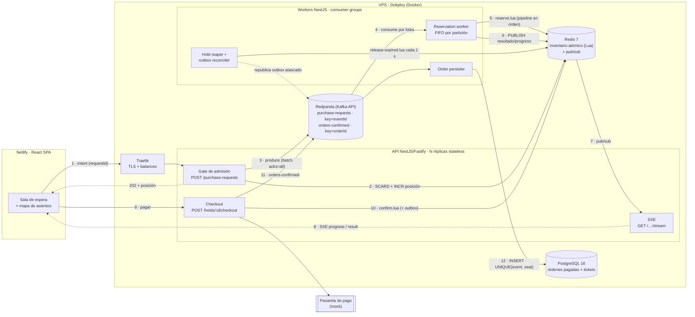
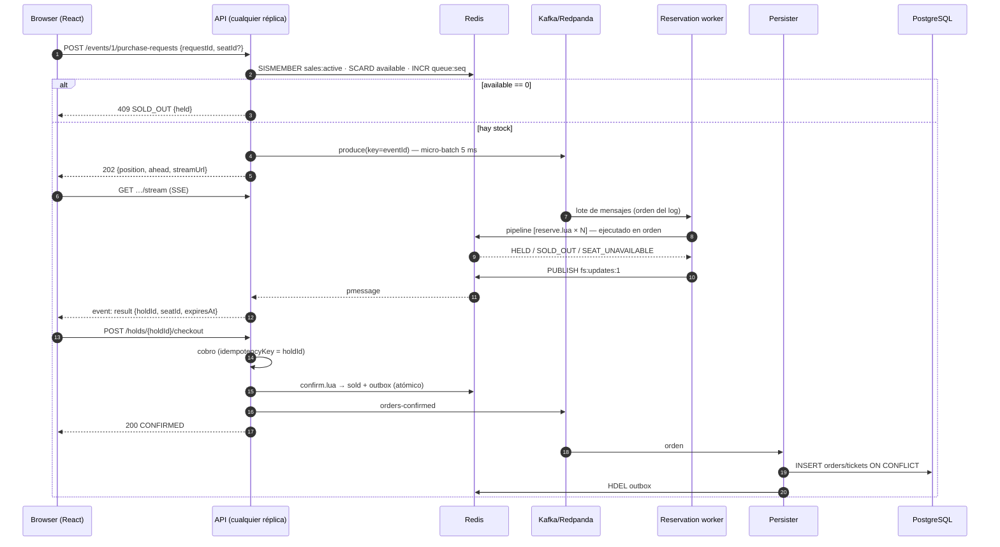
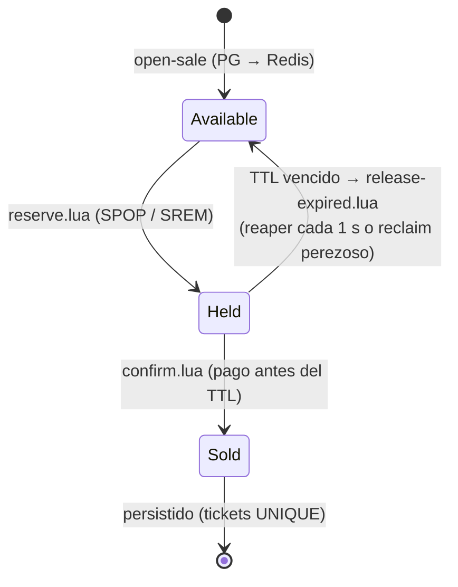

# Arquitectura

> **Redis decide, Kafka ordena, PostgreSQL recuerda.**
> La base de datos solo ve lo que se vendió (≤ capacidad), nunca el tamaño de la multitud.

## 1. Diagrama de componentes



## 2. Secuencia de una compra



## 3. Ciclo de vida de un asiento



**Invariante de conservación** (verificado por `GET /admin/events/:id/audit` y por k6):

```
|available| + |holds| + |sold| == capacity        (siempre, en cada instante)
tickets_en_PG == |sold|                           (cuando el outbox está vacío)
```

---

## 4. Reto 1 — Prevención de sobreventa

**Solución:** el stock es un `SET` de códigos de asiento en Redis. Un asiento sale de él únicamente dentro de [reserve.lua](../backend/src/infra/redis/lua/reserve.lua) mediante `SPOP` (mejor disponible) o `SREM` (asiento concreto). Redis ejecuta los scripts Lua de forma atómica y en un solo hilo: 5.000 llamadas simultáneas se serializan y cada asiento se puede extraer **exactamente una vez**.

| Alternativa | Por qué no |
|---|---|
| `SELECT … FOR UPDATE` en PostgreSQL | 5.000 transacciones peleando por las mismas filas: contención de locks, pool de conexiones agotado, la BD cae justo cuando más se necesita. |
| `DECR stock` + compensar si `< 0` | Funciona para admisión general (GA), pero no identifica *qué* asiento; además deja estados negativos transitorios que hay que compensar. |
| Leer → comprobar → escribir desde Node | Condición de carrera clásica (TOCTOU) entre réplicas. |
| Redlock / locks distribuidos | Más latencia, más casos borde (expiración de lock con pausa de GC) y no aporta nada si la operación ya es atómica. |

**Defensa en profundidad:** aunque Redis fallara, `tickets` tiene `UNIQUE (event_id, seat_id)`. El persister no ignora silenciosamente un conflicto: marca la orden como `CONFLICT` (requiere reembolso) y emite un log `OVERSELL GUARD`. El audit cuenta esas órdenes y k6 falla si hay alguna.

**Evidencia:** [race-test.mjs](../backend/scripts/race-test.mjs) lanza 5.000 `reserve.lua` concurrentes por 50 conexiones contra 100 asientos: 331 ms, exactamente 100 holds, 0 duplicados, y el asiento disputado `S-001` tiene un único ganador.

## 5. Reto 2 — Fila de espera y absorción de tráfico

**El gate** ([purchase.service.ts](../backend/src/modules/purchase/purchase.service.ts)) es lo único que toca la avalancha: un puñado de comandos Redis (auto-pipelined) y un append a Kafka. Sin base de datos. Responde `202` con la posición y el cliente espera el resultado por SSE.

- **Descarte en el borde:** si `available == 0` responde `409 SOLD_OUT` sin encolar. En la prueba de 5.000 usuarios solo ~130–180 peticiones entraron realmente a la cola; el resto se rechazó en ~2 ms. Devuelve `held` para que el cliente sepa si vale la pena reintentar (pueden liberarse asientos).
- **Idempotencia:** el `requestId` (UUID del cliente) evita encolar dos veces el mismo clic.
- **Micro-batching del productor** ([batching-producer.ts](../backend/src/infra/kafka/batching-producer.ts)): un productor idempotente solo admite 1 petición en vuelo; 5.000 `send()` individuales se serializarían. Se acumula durante 5 ms y se envía un único `sendBatch`, encadenando lotes para preservar el orden de llegada.

**FIFO estricto:** la clave del mensaje es `eventId`, así que todas las solicitudes de un evento caen en **una partición**, y una partición la consume **un único** miembro del consumer group, en orden de offset. Las particiones dan paralelismo *entre* eventos.

**Throughput del worker** ([purchase.consumer.ts](../backend/src/workers/purchase.consumer.ts)): los mensajes se procesan en chunks de 250 y cada chunk es **un solo pipeline** de `reserve.lua`. Redis ejecuta los comandos de un pipeline en orden, así que se conserva el FIFO pagando un único round-trip.

> **Matiz honesto:** el orden FIFO canónico es el orden del log de Kafka. La `position` que ve el usuario sale de un `INCR` en el gate; con varias réplicas de API dos peticiones casi simultáneas pueden quedar en el log en orden inverso a su número. Es una aproximación para la UX, no la fuente de verdad del orden.

**¿Por qué una cola si Redis ya es atómico?** Redis por sí solo evita la sobreventa. La cola aporta: (1) **equidad** — orden de llegada explícito y auditable; (2) **backpressure** — los workers consumen a su ritmo y escalan independientemente de la API; (3) **durabilidad de la intención** — si caen los workers, nada se pierde, se reanuda desde el offset; (4) **replay** para depurar un incidente.

**Entrega at-least-once:** el offset se confirma después de que Redis haya escrito los resultados. Si un mensaje se reentrega, `reserve.lua` devuelve el resultado cacheado en `ev:{E}:req:{R}` en lugar de reservar otro asiento.

## 6. Reto 3 — Bloqueo temporal (TTL)

Al reservar se escribe, dentro del mismo script atómico:

- `ZADD ev:{E}:holds <expiresAt> <seat>` — la expiración, con el reloj **del servidor Redis** (`TIME`), nunca el del cliente.
- `HSET ev:{E}:holdmeta <seat> <holdId|userId>` — propietario.
- `SET ev:{E}:user:{U} <holdId|seat> PX <ttl>` — un hold activo por usuario; esta clave sí expira sola.

La devolución al stock la hace [release-expired.lua](../backend/src/infra/redis/lua/release-expired.lua), por dos vías:

1. **Activa:** el reaper ([maintenance.service.ts](../backend/src/workers/maintenance.service.ts)) la ejecuta cada segundo en cada worker. Es seguro tenerla en varias réplicas porque el script es atómico.
2. **Perezosa:** el propio `reserve.lua` reclama hasta 50 holds vencidos antes de hacer `SPOP`, así el inventario se recupera aunque el reaper esté caído (es la misma estrategia que usa Redis para expirar claves).

**¿Por qué no `EXPIRE` + keyspace notifications?** Las notificaciones son pub/sub *fire-and-forget*: si ningún suscriptor está conectado en el momento de la expiración, el evento se pierde y ese asiento queda fuera del inventario para siempre. Un ZSET ordenado por expiración es durable y se puede barrer en cualquier momento.

**Pago en el límite del TTL:** `confirm.lua` vuelve a comprobar la expiración de forma atómica. Si el cobro terminó cuando el hold ya había vencido, la API **reembolsa** y responde `410`. (Mejora posible: extender el hold 60 s al iniciar el checkout).

## 7. Consistencia Redis ↔ PostgreSQL

| Riesgo | Mitigación |
|---|---|
| La API cae entre confirmar en Redis y publicar en Kafka | `confirm.lua` escribe la orden en `ev:{E}:outbox` **en el mismo paso atómico** (patrón outbox dentro de Redis). El reconciler republica las entradas con más de 30 s. |
| Mensaje duplicado (reintento, republicación del outbox) | `orders.id = holdId` + `ON CONFLICT DO NOTHING`: el persister es idempotente. |
| Redis pierde datos (crash) | AOF `everysec` (≤1 s de pérdida). `POST /admin/events/:id/open-sale` reconstruye `available = asientos − tickets vendidos` desde PG. Los holds en curso se pierden, y es aceptable: el usuario vuelve a la cola. |
| Redis desaloja claves por memoria | `maxmemory-policy noeviction`: Redis rechaza escrituras antes que borrar inventario. |
| PostgreSQL caído | El checkout sigue funcionando (Redis + outbox). Kafka retiene `orders-confirmed` y el persister se pone al día cuando vuelve PG. |

## 8. Tiempo real: SSE

Se eligió **SSE** en lugar de WebSockets: el flujo es unidireccional (servidor → cliente), es HTTP plano (pasa por Traefik/CDN sin configuración extra), y `EventSource` reconecta solo.

- **Una** suscripción `PSUBSCRIBE fs:updates:*` por réplica de API, demultiplexada en memoria a miles de streams ([realtime.service.ts](../backend/src/modules/realtime/realtime.service.ts)). Los resultados se enrutan por `requestId` en O(1).
- El progreso se publica **una vez por chunk** (no por petición) y se limita a 4 eventos/s por evento: con 5.000 clientes, emitir progreso por cada mensaje sería un fan-out cuadrático.
- Como pub/sub puede perder mensajes (reconexión, réplica reiniciada), cada stream vuelve a comprobar `ev:{E}:req:{R}` cada 5 s. Eso también resuelve la carrera "el resultado llegó antes de suscribirse".
- Cualquier réplica sirve cualquier stream, así que no hacen falta sticky sessions.

## 9. Despliegue

| Pieza | Dónde | Notas |
|---|---|---|
| React SPA | Netlify | `VITE_API_URL` apunta al dominio de la API. |
| API ×3, Worker ×2 | VPS / Dokploy | Misma imagen, distinto `command`. |
| Redis, Redpanda, PostgreSQL | VPS / Dokploy | Sin puertos publicados, solo red interna. |
| Traefik | Dokploy | TLS + balanceo entre réplicas de `api`. En local lo sustituye nginx ([nginx.dev.conf](../deploy/nginx.dev.conf)). |

## 10. Limitaciones conocidas y siguiente nivel

- **Puntos únicos de fallo en un solo VPS:** Redis y Redpanda tienen un nodo cada uno. Siguiente paso: Redis Sentinel o un servicio gestionado, y Redpanda con 3 nodos (`replication.factor=3`). Las claves ya usan hash tags `{eventId}`, así que el esquema es compatible con Redis Cluster.
- **Throughput por evento:** limitado por una partición y un hilo de Redis. Medido: unas 15.000 reservas/s solo en Redis, muy por encima de lo que necesita una venta real.
- **Autenticación de demo** (`x-user-id`): sustituir por JWT (en SSE, mediante cookie o token de corta vida en la query, porque `EventSource` no envía cabeceras).
- **Sala de espera por lotes** (estilo Queue-it): admitir N usuarios por minuto antes de mostrar el mapa de asientos. Encaja delante del gate actual sin cambiarlo.
- **Rate limiting** por IP o usuario en Traefik.
- **Observabilidad:** métricas Prometheus (lag del consumer, tamaño del outbox, holds activos) y un dashboard en Grafana.
