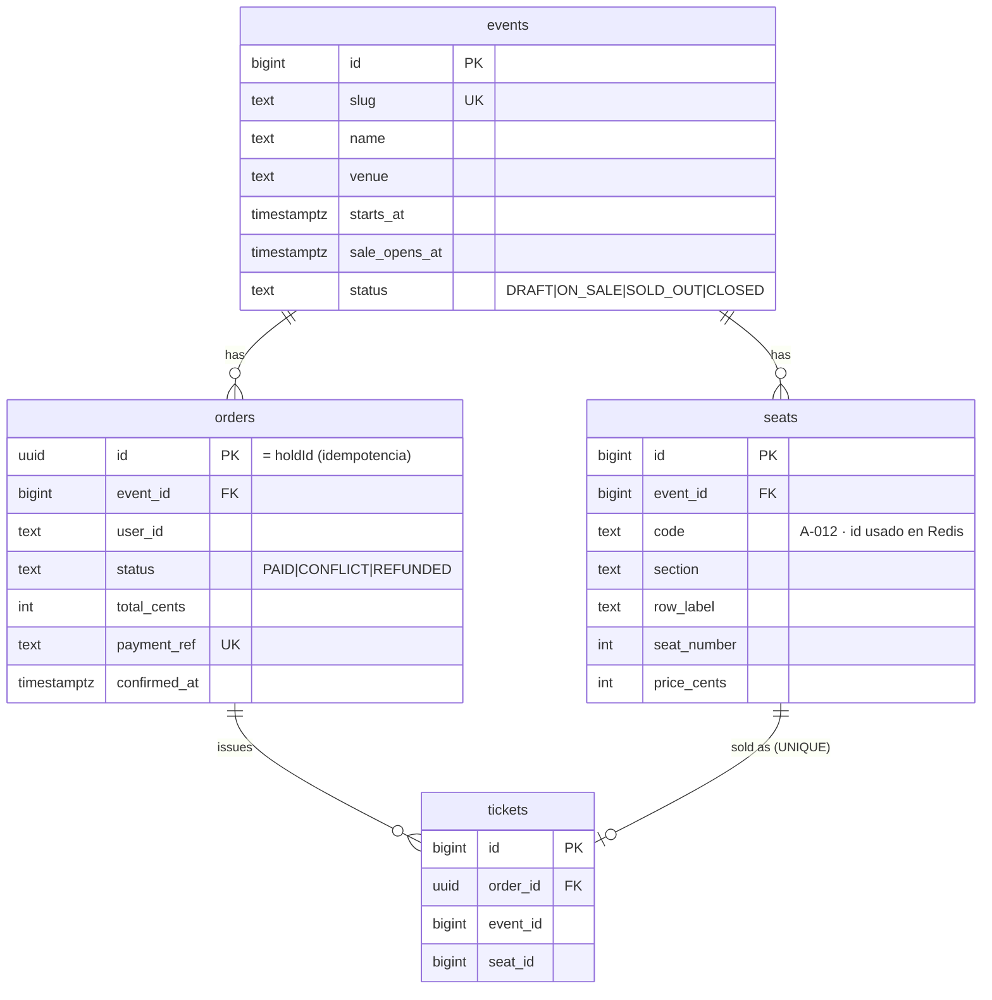

# Modelo de datos

Dos almacenes con responsabilidades separadas:

| | Redis | PostgreSQL |
|---|---|---|
| Rol | Estado **caliente y efímero**: qué está libre, retenido o vendido *ahora* | Estado **durable**: catálogo, órdenes pagadas, tickets emitidos |
| Escrituras durante la venta | Una por cada intento de compra | Una por cada venta confirmada (≤ capacidad) |
| Fuente de verdad de | Inventario durante la venta | Lo vendido (Redis se reconstruye desde aquí) |

Los **holds no se guardan en PostgreSQL**: duran 5 minutos y convertirían cada clic en una escritura en la BD, que es justo lo que esta arquitectura evita.

## PostgreSQL

Migraciones en [db/migrations](../db/migrations) (se ejecutan solas en el primer arranque del contenedor).



Decisiones clave:

- **`tickets_one_per_seat UNIQUE (event_id, seat_id)`**: última línea de defensa contra la sobreventa. Físicamente no pueden existir dos tickets para el mismo asiento.
- **FK compuesta `(event_id, seat_id) → seats(event_id, id)`**: un ticket no puede apuntar a un asiento de otro evento.
- **`orders.id = holdId`**: la clave de idempotencia es la PK. Las reentregas de Kafka y las republicaciones del outbox se resuelven con `ON CONFLICT DO NOTHING`.
- **`payment_ref UNIQUE`**: un cobro genera una sola orden.
- **`status = 'CONFLICT'`** con índice parcial: cola de órdenes que requieren reembolso manual. Debería estar siempre vacía.
- `user_id` es `text`: la identidad la gestiona un proveedor externo (el `sub` del JWT).

## Redis

Todas las claves de un evento comparten el hash tag `{E}`, así que viven en el mismo slot y un script Lua puede tocarlas todas (compatible con Redis Cluster). Definidas en [keys.ts](../backend/src/infra/redis/keys.ts).

| Clave | Tipo | Contenido | Escrita por |
|---|---|---|---|
| `ev:{E}:available` | SET | códigos de asiento vendibles | open-sale, reserve, release |
| `ev:{E}:holds` | ZSET | asiento → `expiresAt` (ms) | reserve, confirm, release |
| `ev:{E}:holdmeta` | HASH | asiento → `holdId\|userId` | reserve, confirm, release |
| `ev:{E}:sold` | SET | códigos vendidos | confirm |
| `ev:{E}:user:{U}` | STRING + PX | `holdId\|seat`: 1 hold activo por usuario | reserve, confirm |
| `ev:{E}:req:{R}` | STRING + EX 1h | resultado JSON de la solicitud (idempotencia + polling) | reserve |
| `ev:{E}:reqpos:{R}` | STRING + EX 1h | posición en la cola | gate |
| `ev:{E}:queue:seq` | STRING | última posición asignada (`INCR`) | gate |
| `ev:{E}:queue:done` | STRING | última posición procesada | reserve |
| `ev:{E}:outbox` | HASH | holdId → orden JSON pendiente de persistir | confirm / persister |
| `ev:{E}:confirmed` | HASH | holdId → `seat\|userId` (confirm idempotente) | confirm |
| `ev:{E}:prices` | HASH | asiento → precio en céntimos (checkout sin PG) | open-sale |
| `ev:{E}:meta` | HASH | `capacity`, `openedAt` | open-sale |
| `sales:active` | SET | eventIds en venta (los recorren el reaper y el reconciler) | open-sale / close-sale |
| canal `fs:updates:{E}` | pub/sub | `result`, `progress`, `inventory` | workers |

Configuración obligatoria del servidor: `maxmemory-policy noeviction`, `appendonly yes`, `appendfsync everysec`.

### Comandos clave (equivalente redis-cli)

Lo que hacen los scripts, paso a paso. **Ejecutarlos sueltos desde la app NO sería atómico**: por eso viven en Lua.

```bash
# --- Abrir venta (open-sale) ---------------------------------------------
SADD  ev:{1}:available A-001 A-002 ... D-025
HSET  ev:{1}:prices    A-001 8000 ...
SADD  sales:active 1

# --- reserve.lua: mejor disponible ---------------------------------------
GET   ev:{1}:req:<requestId>                       # ¿ya procesada? → devolver caché
ZRANGEBYSCORE ev:{1}:holds -inf <now> LIMIT 0 50   # reclaim perezoso de vencidos
GET   ev:{1}:user:alice                            # ¿ya tiene un hold?
SPOP  ev:{1}:available                             # ← el "decremento atómico"
ZADD  ev:{1}:holds <now+300000> A-007
HSET  ev:{1}:holdmeta A-007 "<holdId>|alice"
SET   ev:{1}:user:alice "<holdId>|A-007" PX 300000
SET   ev:{1}:req:<requestId> '{"status":"HELD",...}' EX 3600

# --- reserve.lua: asiento concreto ---------------------------------------
SREM  ev:{1}:available A-007     # 1 = es tuyo · 0 = SEAT_UNAVAILABLE

# --- confirm.lua ----------------------------------------------------------
HGET  ev:{1}:holdmeta A-007      # ¿coincide holdId|userId?
ZSCORE ev:{1}:holds A-007        # ¿expiresAt > now?
ZREM  ev:{1}:holds A-007
HDEL  ev:{1}:holdmeta A-007
SADD  ev:{1}:sold A-007
DEL   ev:{1}:user:alice
HSET  ev:{1}:outbox <holdId> '<order json>'
HSET  ev:{1}:confirmed <holdId> "A-007|alice"

# --- release-expired.lua (reaper, cada 1 s) -------------------------------
ZRANGEBYSCORE ev:{1}:holds -inf <now> LIMIT 0 500
# por cada asiento: ZREM holds · HDEL holdmeta · SADD available

# --- Inspección / auditoría ------------------------------------------------
SCARD ev:{1}:available
ZCARD ev:{1}:holds
SCARD ev:{1}:sold
ZRANGE ev:{1}:holds 0 -1 WITHSCORES
```

### Por qué un SET y no un contador

Un contador (`DECR`) basta para admisión general, pero un SET de códigos:

- dice **qué** asiento se asignó (no solo cuántos quedan),
- hace que reservar un asiento concreto (`SREM` → 0/1) y uno cualquiera (`SPOP`) sean operaciones O(1) igual de atómicas,
- y hace verificable la conservación: `SCARD available + ZCARD holds + SCARD sold == capacity`.

Para eventos de admisión general sin asientos numerados, se puede usar el mismo diseño con códigos sintéticos (`GA-00001…`).
